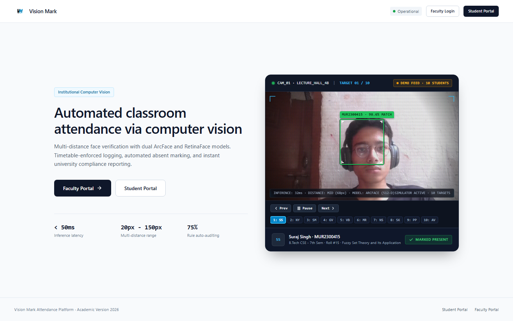
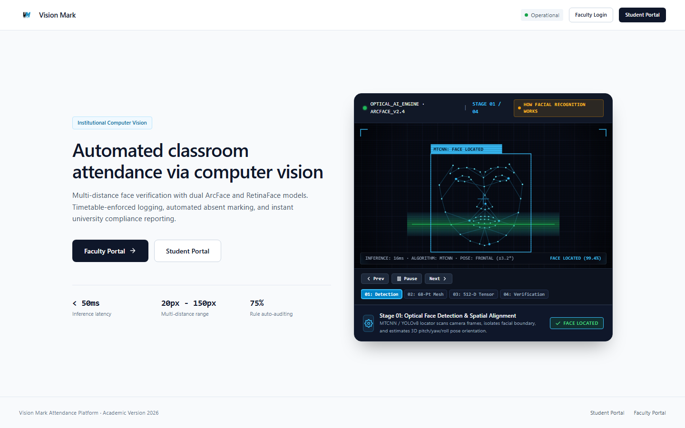
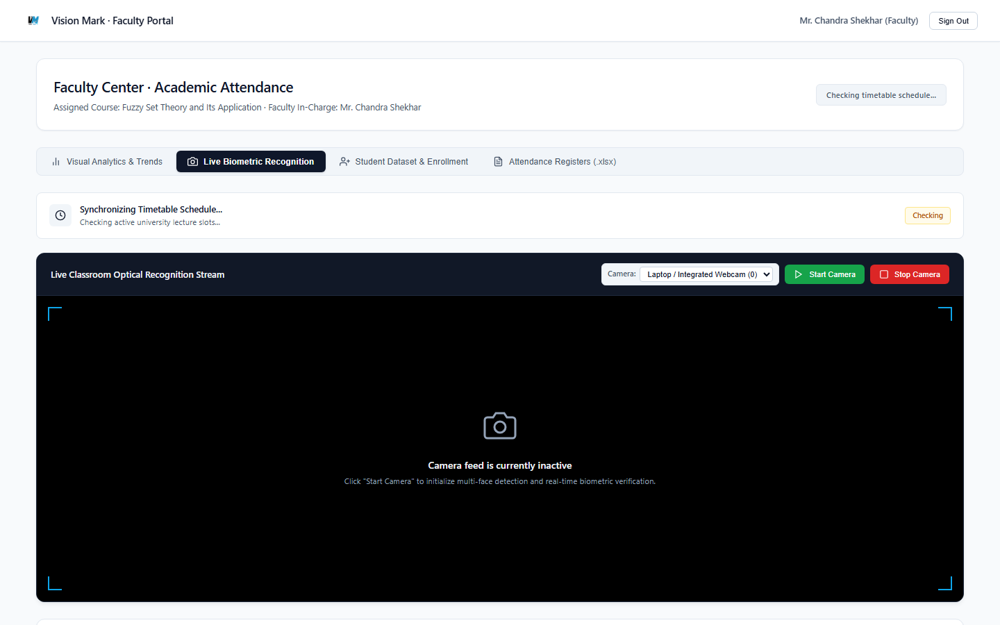
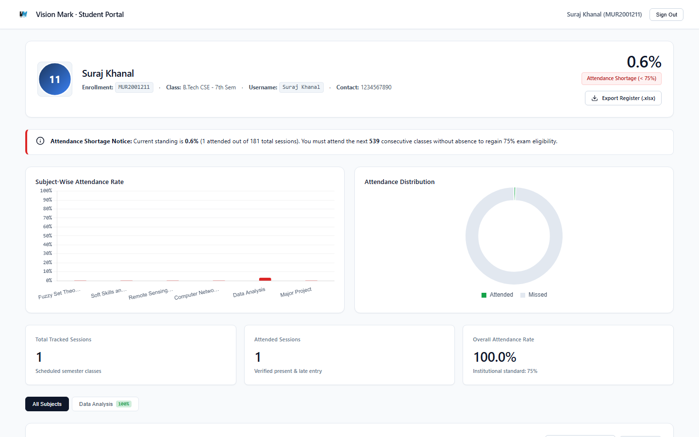
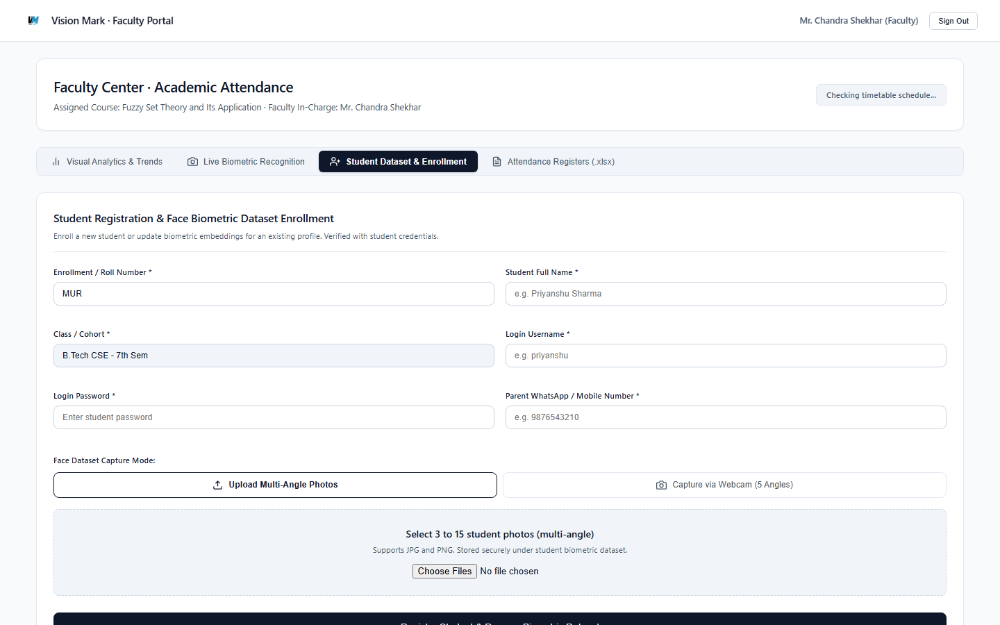
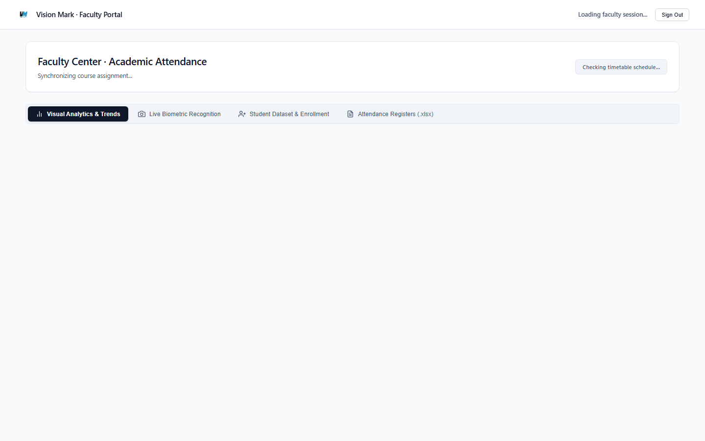
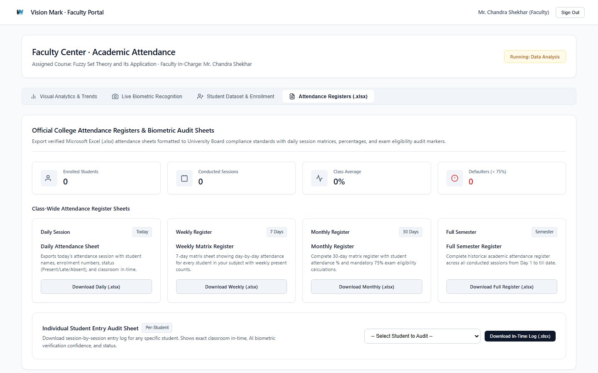

<div align="center">

# 🎓 Vision Mark
### Enterprise Autonomous Facial Recognition Attendance Platform

[](https://www.python.org/)
[](https://fastapi.tiangolo.com/)
[](https://github.com/deepinsight/insightface)
[](https://tidbcloud.com/)
[](tests/test_security_suite.py)
[](LICENSE)

> A modern, production-ready computer vision attendance platform featuring **multi-distance face recognition**, **in-browser camera streaming**, **hierarchical cascade matching**, and **automated academic ERP ledger enforcement**.

[Explore Features](#-core-features) · [UI Showcase](#-user-interface--dashboards) · [System Architecture](#-biometric-engine-architecture) · [Quickstart](#-quickstart-guide) · [Security & Privacy](#-enterprise-security--privacy)

<br/>



</div>

---

## 📸 User Interface & Dashboards

| Landing Page & Real-Time CV Pipeline | Faculty Live Attendance Portal |
| :---: | :---: |
|  |  |
| *Authentic 5-Stage Biometric Computer Vision Pipeline* | *In-Browser Live Camera Stream & Multi-Face Recognition* |

| Student Analytics Dashboard | Biometric 5-Angle Enrollment |
| :---: | :---: |
|  |  |
| *Real-time attendance rates, streaks, and subject breakdown* | *Multi-angle face registration with automatic embeddings* |

| Institutional Analytics & Overview | Class Attendance Ledger & Excel Export |
| :---: | :---: |
|  |  |
| *Daily metrics, attendance rate trends, and subject health* | *Complete institutional ledger with single-click Excel export* |

---

## 📋 Table of Contents

- [User Interface & Dashboards](#-user-interface--dashboards)
- [Core Features](#-core-features)
- [Biometric Engine Architecture](#-biometric-engine-architecture)
- [System Architecture](#-system-architecture)
- [Quickstart Guide](#-quickstart-guide)
  - [Prerequisites](#1-prerequisites)
  - [Local Installation](#2-local-installation)
  - [Environment Configuration](#3-environment-configuration)
  - [Database Setup (TiDB Cloud / MySQL)](#4-database-setup)
  - [Run the Application](#5-run-the-application)
- [In-Browser Camera Streaming](#-in-browser-camera-streaming)
- [Enterprise Security & Privacy](#-enterprise-security--privacy)
- [API Reference](#-api-reference)
- [Project Directory Structure](#-project-directory-structure)
- [License & Citation](#-license--citation)

---

## ✨ Core Features

### 🎯 Multi-Distance Facial Recognition
* **Adaptive Distance Categorization:** Dynamically classifies detected faces into four spatial categories based on pixel bounding box width:
  * `Very Close` ($\ge 150\text{px}$) · `Close` ($80\text{px} - 149\text{px}$) · `Mid` ($40\text{px} - 79\text{px}$) · `Far` ($20\text{px} - 39\text{px}$).
* **Dynamic Distance-Adaptive Thresholds:** Dynamically scales cosine acceptance thresholds ($0.25 - 0.40$) based on distance to ensure zero false positives while retaining high long-distance recall.
* **4-Level Hierarchical Cascade Matching:**
  1. *Level 1:* Same distance category vector match (`student_embeddings`)
  2. *Level 2:* Adjacent distance category fallback (`get_adjacent_categories`)
  3. *Level 3:* Category-specific average centroid fallback (`student_detail`)
  4. *Level 4:* Global normalized average embedding

### 🌐 In-Browser Camera Streaming (Zero Server Hardware Dependency)
* **WebRTC / HTML5 Client Ingestion:** Teachers and students can mark attendance directly from their personal laptop, tablet, or smartphone web camera using `navigator.mediaDevices.getUserMedia`.
* **Zero Physical Server Camera Required:** Solves the cloud deployment bottleneck—the server processes incoming frames via `POST /api/recognize_frame`, requiring zero physical USB cameras attached to the deployment host.
* **Dual Camera Engine:** Seamlessly toggle between **Browser Device Camera** (client-side) and **Direct Server Camera** (physical USB/RTSP) from the dashboard.

### 🏛️ Academic Timetable & Attendance Rules
* **Active Timetable Enforcement:** Matches detection timestamps against active lecture schedules (`DummyTimeTable`), validating Subject, Room, and Faculty.
* **60-Second Anti-Duplicate Cooldown:** Eliminates spam and duplicate records by arming a 60-second duplicate suppression window for recognized students.
* **Multi-Class Increment:** Naturally supports multiple classes in a single day, incrementing session totals accurately without artificially inflating days.
* **Automated Absence Marking & Backfill:** Background scheduler automatically flags unverified students as absent once the lecture duration and grace period expire.

---

## 🧬 Biometric Engine Architecture

Vision Mark operates on an authentic 5-stage computer vision and deep learning pipeline:

```
┌──────────────────────────────┐
│  Stage 01: Optical Ingestion │  InsightFace det_10g (640×640)
│  & Distance Bounding         │  Dynamic Category: Very Close (≥150px) / Close / Mid / Far
└──────────────┬───────────────┘
               │
               ▼
┌──────────────────────────────┐
│  Stage 02: 5-Point Affine    │  Locates Left Eye, Right Eye, Nose Tip, Left/Right Mouth
│  Landmark Normalization      │  Computes affine matrix; normalizes pose yaw/pitch to 112×112
└──────────────┬───────────────┘
               │
               ▼
┌──────────────────────────────┐
│  Stage 03: ArcFace ResNet-50 │  Deep CNN backbone (w600k_r50.onnx)
│  512-D Embedding Extraction  │  Maps facial morphology onto unit hypersphere ℝ⁵¹² (||E||₂ = 1.0)
└──────────────┬───────────────┘
               │
               ▼
┌──────────────────────────────┐
│  Stage 04: 4-Level Distance  │  Level 1: Same Category ➔ Level 2: Adjacent ➔ Level 3: Average
│  Cascade & Cosine Metric     │  Dynamic threshold verification (e.g. Cosine Similarity ≥ 0.30)
└──────────────┬───────────────┘
               │
               ▼
┌──────────────────────────────┐
│  Stage 05: Academic Ledger   │  Validates active timetable (Subject / Faculty / Time Slot)
│  & Cloud ERP Commit          │  Enforces 60s duplicate suppression; commits encrypted TiDB record
└──────────────────────────────┘
```

---

## 🏗️ System Architecture

```
                               ┌──────────────────────────────────────────────┐
                               │             Client Web Browser               │
                               │   (HTML5, Canvas HUD, getUserMedia HTTPS)    │
                               └──────────────────────┬───────────────────────┘
                                                      │
                       HTTPS REST API / WebRTC Frames │ Signed Cookies (HMAC-SHA256)
                                                      ▼
┌─────────────────────────────────────────────────────────────────────────────────────────────┐
│                                FastAPI Server (main.py / backend.server)                    │
│                                                                                             │
│  ┌────────────────────────┐  ┌────────────────────────┐  ┌────────────────────────┐         │
│  │    Auth & Security     │  │  In-Browser Streaming  │  │   Analytics & Excel    │         │
│  │ (Bcrypt, Signed Sess,  │  │ (/api/recognize_frame, │  │   Report Exporter      │         │
│  │  SlowAPI Rate Limiter) │  │  client-side frames)   │  │   (OpenPyXL / Pandas)  │         │
│  └────────────────────────┘  └────────────────────────┘  └────────────────────────┘         │
│                                           │                                                 │
│                                           ▼                                                 │
│  ┌────────────────────────────────────────────────────────────────────────────────┐         │
│  │                     Vision Mark Biometric Engine (Recognize2.py)               │         │
│  │  ┌──────────────────────┐  ┌──────────────────────┐  ┌──────────────────────┐  │         │
│  │  │ InsightFace det_10g  │  │ 5-Point Affine Warp  │  │ ArcFace ResNet-50    │  │         │
│  │  │ Multi-Distance Class │  │ Canonical 112×112    │  │ 512-D Normalized     │  │         │
│  │  └──────────────────────┘  └──────────────────────┘  └──────────────────────┘  │         │
│  └────────────────────────────────────────────────────────────────────────────────┘         │
└───────────────────────────────────────────┬─────────────────────────────────────────────────┘
                                            │
                        TLS Encrypted MySQL │ SSL Handshake
                                            ▼
┌─────────────────────────────────────────────────────────────────────────────────────────────┐
│                          Database Layer (TiDB Cloud Serverless / MySQL)                     │
│  ┌────────────────────────┐  ┌────────────────────────┐  ┌────────────────────────┐         │
│  │   students / teachers  │  │   student_embeddings   │  │   attendance_<subject> │         │
│  │   (Bcrypt hashes)      │  │ (Multi-Distance Blobs) │  │  (Timetable Ledgers)   │         │
│  └────────────────────────┘  └────────────────────────┘  └────────────────────────┘         │
└─────────────────────────────────────────────────────────────────────────────────────────────┘
```

---

## 💻 Quickstart Guide

### 1. Prerequisites
* **Python 3.10+**
* **MySQL 8.0+** or **TiDB Cloud Serverless** account (Free tier)
* **Webcam** (built-in laptop camera, USB webcam, or mobile camera)

### 2. Local Installation

```bash
# Clone repository
git clone https://github.com/Git-Suraj-hub/Vision_Mark.git
cd Vision_Mark

# Create virtual environment
python -m venv venv

# Activate virtual environment
# Windows:
venv\Scripts\activate
# Linux/macOS:
source venv/bin/activate

# Install verified dependencies
pip install --upgrade pip
pip install -r requirements.txt
```

### 3. Environment Configuration

Create a `.env` file in the root directory (refer to `pythonProject4/.env.example`):

```env
# Database Configuration (TiDB Cloud Serverless or Local MySQL)
DB_HOST=gateway01.ap-northeast-1.prod.aws.tidbcloud.com
DB_PORT=4000
DB_USER=your_tidb_user
DB_PASSWORD=your_tidb_password
DB_NAME=face_detection
DB_SSL_DISABLED=False

# Session Security & Application Secrets
SECRET_KEY=generate_a_secure_random_hex_string_32_bytes
SESSION_EXPIRE_SECONDS=21600

# Server Binding
HOST=0.0.0.0
PORT=8000

# Default Camera Source (0 for internal webcam, or RTSP stream)
DEFAULT_CAMERA_SOURCE=0
```

### 4. Database Setup

Execute the schema files in `pythonProject4/database/` into your MySQL / TiDB database:

```bash
mysql -h <DB_HOST> -P <DB_PORT> -u <DB_USER> -p <DB_NAME> < pythonProject4/database/01_base_tables.sql
mysql -h <DB_HOST> -P <DB_PORT> -u <DB_USER> -p <DB_NAME> < pythonProject4/database/02_subject_tables.sql
mysql -h <DB_HOST> -P <DB_PORT> -u <DB_USER> -p <DB_NAME> < pythonProject4/database/03_embeddings_table.sql
mysql -h <DB_HOST> -P <DB_PORT> -u <DB_USER> -p <DB_NAME> < pythonProject4/database/04_category_columns.sql
mysql -h <DB_HOST> -P <DB_PORT> -u <DB_USER> -p <DB_NAME> < pythonProject4/database/05_timetable.sql
```

### 5. Run the Application

```bash
# Launch via root entrypoint
python main.py
```

Open your browser at `http://localhost:8000`.

---

## 📷 In-Browser Camera Streaming

In cloud deployments, the server does not have a physical USB webcam attached. Vision Mark solves this natively:

1. **Client Ingestion:** When faculty opens the Faculty Portal and clicks **Start Camera**, the browser requests camera permissions via WebRTC (`getUserMedia`).
2. **Local Rendering:** Video is captured and displayed smoothly on the user's local screen using their device's GPU.
3. **HTTP Streaming:** The browser sends JPEG frames asynchronously to `POST /api/recognize_frame`.
4. **Instant Detection:** The backend runs ArcFace on the frame, returning bounding box coordinates and recognized student details to the client canvas in real time.

---

## 🛡️ Enterprise Security & Privacy

Vision Mark underwent a complete pre-deployment security audit and includes an automated test suite verifying 100% compliance across 17 checkpoints:

| Checkpoint | Description | Implementation | Status |
| :--- | :--- | :--- | :---: |
| **SEC-01** | Student Attendance Protection | Role-based check; students can only view their own records (401/403) | **PASS** |
| **SEC-02** | Password Privacy & Hashing | Passwords excluded from all API responses; automatic live Bcrypt migration | **PASS** |
| **SEC-03** | Student Photo Protection | Profile photos strictly guarded behind student/faculty ownership check | **PASS** |
| **SEC-04** | Biometric Storage Isolation | Captures moved outside public static into protected storage (`/storage/captures/`) | **PASS** |
| **SEC-05** | Surveillance Stream Guard | Video feed & webcam status restricted exclusively to authorized faculty | **PASS** |
| **SEC-06** | Brute-Force Rate Limiting | `slowapi` rate limiter restricts login attempts (HTTP 429 Too Many Requests) | **PASS** |
| **SEC-07** | DOM XSS Immunity | Safe DOM element construction with zero vulnerable `innerHTML` concatenation | **PASS** |
| **SEC-08** | Server-side Input Validation | Strict Regex validation (`^[A-Za-z0-9_-]{3,30}$`) preventing injection | **PASS** |

### Run the Security Suite

```bash
python pythonProject4/tests/test_security_suite.py
```

---

## 📡 API Reference

### Authentication & Sessions
* `POST /api/login` - Authenticate student or teacher (Rate-limited, sets signed cookie)
* `POST /api/logout` - Invalidate session token
* `GET /api/current_user` - Retrieve active session claims

### Attendance & Recognition
* `POST /api/recognize_frame` - **In-Browser Camera Engine**: Process incoming base64 frame and return detections
* `GET /api/student/attendance/{enrollment_no}` - Fetch student attendance breakdown (SEC-01 Protected)
* `GET /api/teacher/attendance` - Fetch faculty's assigned subject attendance ledger
* `POST /api/mark_attendance` - Manual attendance override with timetable validation
* `GET /api/student/export_my_report` - Download individual Excel attendance report
* `GET /api/teacher/export_excel` - Export full class attendance report with percentages

### Camera Controls (Server Direct)
* `POST /api/start_webcam` - Initialize server-side OpenCV video stream
* `GET /api/stop_webcam` - Terminate server-side camera thread
* `GET /api/video_feed` - Multipart MJPEG stream (Faculty only, SEC-05 Protected)
* `GET /api/webcam_status` - Get live status of server camera

---

## 📁 Project Directory Structure

```
Vision_Mark/
├── docs/images/                    # High-resolution UI screenshots & architecture assets
├── requirements.txt                # Production Python dependencies
├── README.md                       # Comprehensive documentation
├── pythonProject4/
│   ├── .env.example                # Sanitized environment template
│   ├── backend/
│   │   ├── server.py               # Core FastAPI web service & secure endpoints
│   │   ├── Recognize2.py           # Multi-distance ArcFace & cascade matcher
│   │   ├── student_embeddings.py   # 5-angle dataset feature extractor
│   │   ├── student_detail_embedding.py # Distance category centroid calculator
│   │   ├── static/                 # Static assets (CSS, JS, Logos)
│   │   └── templates/              # Redesigned Unslop institutional templates
│   │       ├── index.html          # Landing page with authentic 5-stage CV visualizer
│   │       ├── login_student.html  # Secure student authentication
│   │       ├── login_teacher.html  # Secure faculty authentication
│   │       ├── student.html        # Student attendance dashboard & analytics
│   │       └── teacher.html        # Faculty dashboard with In-Browser WebRTC camera
│   ├── database/                   # Relational database schemas (MySQL / TiDB)
│   ├── storage/                    # Isolated biometric captures (SEC-04 Protected)
│   └── tests/
│       └── test_security_suite.py  # 17-point automated security verification suite
```

---

## 📄 License & Citation

This project is licensed under the **MIT License** - see the [LICENSE](LICENSE) file for details.

If you use Vision Mark in your academic research or institutional deployment, please cite:

```bibtex
@software{vision_mark_2026,
  author = {Suraj and DeepMind Team},
  title = {Vision Mark: Enterprise Multi-Distance Facial Recognition Attendance Platform},
  year = {2026},
  publisher = {GitHub},
  url = {https://github.com/Git-Suraj-hub/Vision_Mark}
}
```

---

<div align="center">
  <sub>Built with academic rigor for universities and educational institutions.</sub>
</div>
