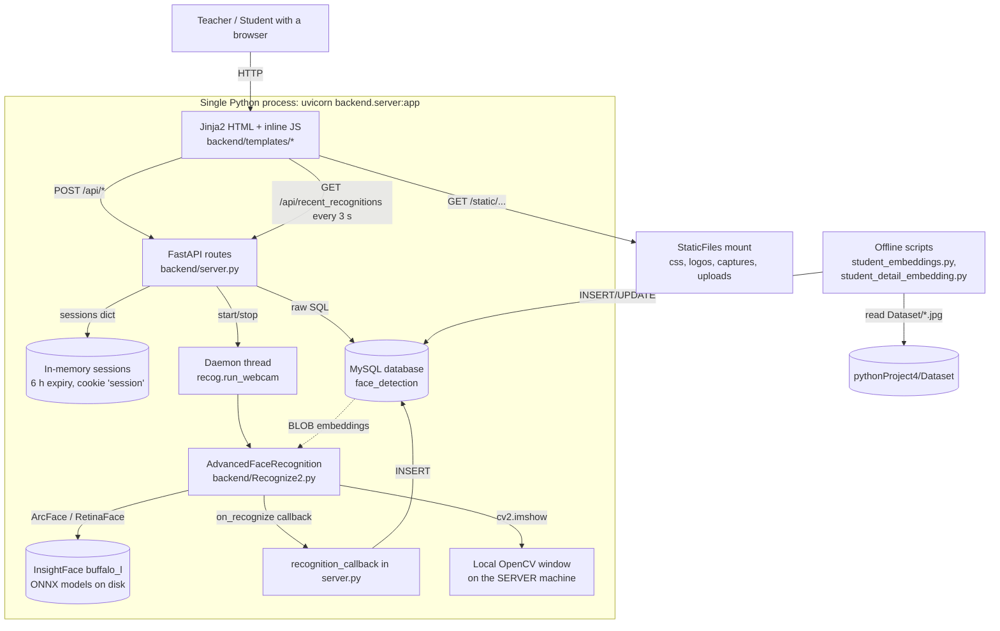
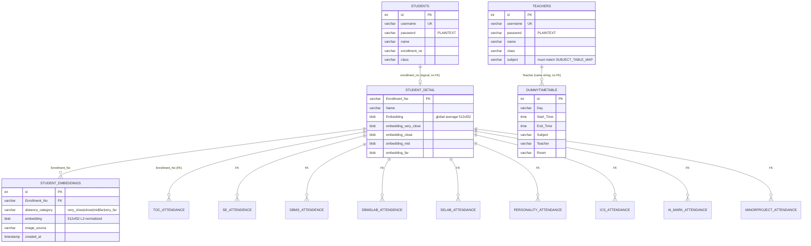

# Vision Mark — Developer Guide

> Complete onboarding, architecture, and runbook reference.
> Generated from the **actual repository + live database + verified runtime** (last verified: 2026-09-25).
> Anything marked **NOT FOUND / NOT CONFIRMED** really does not exist in this repository.

---

## Table of Contents

1. [Project Overview](#1-project-overview)
2. [30-Minute Quick Start](#2-30-minute-quick-start)
3. [Architecture](#3-architecture)
4. [Repository Structure](#4-repository-structure)
5. [Prerequisites](#5-prerequisites)
6. [Installation](#6-installation)
7. [Environment Variables](#7-environment-variables)
8. [Running the Project](#8-running-the-project)
9. [Application Workflow](#9-application-workflow)
10. [Frontend](#10-frontend)
11. [Backend](#11-backend)
12. [API Documentation](#12-api-documentation)
13. [AI/ML Pipeline](#13-aiml-pipeline)
14. [Database](#14-database)
15. [File Storage](#15-file-storage)
16. [Authentication & Security](#16-authentication--security)
17. [Testing](#17-testing)
18. [Debugging](#18-debugging)
19. [Common Problems](#19-common-problems)
20. [Adding New Features](#20-adding-new-features)
21. [Adding AI/ML Features](#21-adding-aiml-features)
22. [Deployment](#22-deployment)
23. [Git Workflow](#23-git-workflow)
24. [Project History](#24-project-history)
25. [Performance](#25-performance)
26. [First Contribution](#26-first-contribution)
27. [Important Files](#27-important-files)
28. [TODOs / Known Issues](#28-todos--known-issues)
29. [Glossary](#29-glossary)
30. [Final Developer Cheat Sheet](#30-final-developer-cheat-sheet)

---

## 1. Project Overview

### What is Vision Mark?

**Vision Mark** is an AI-powered **classroom attendance system**. A teacher logs into a web
dashboard, presses *Start Recognition*, and a webcam reads the faces of students in the room.
Recognized students are automatically marked **Present** in a MySQL database for the subject that
is currently running according to a timetable. Teachers can also mark attendance manually, and
students can log in to see their own attendance per subject.

| Question | Answer (confirmed from code) |
| --- | --- |
| What problem does it solve? | Manual, paper-based classroom attendance |
| Who uses it? | **Teachers** (mark/monitor) and **Students** (view own attendance) |
| Main workflow | Login → teacher starts webcam → faces detected → matched → attendance row inserted into the subject's table → dashboards display it |
| AI/ML parts | Face detection (SCRFD / RetinaFace), face embedding (ArcFace 512-d), cosine-similarity matching, (experimental) SVM/KNN trainers in `Far/` |
| Traditional software | FastAPI web server, Jinja2 HTML pages, vanilla JS, MySQL, session cookies |
| External services | **None.** Only the InsightFace model download from GitHub on first run |

### Tech stack (actual, from imports)

| Layer | Technology |
| --- | --- |
| Web framework | FastAPI (`fastapi`), served by **Uvicorn** |
| Templating | Jinja2 (`fastapi.templating.Jinja2Templates`) |
| Frontend | HTML5 + single shared `style.css` + inline vanilla JS (no npm, no React) |
| Database | MySQL (`mysql-connector-python`), **no ORM**, raw SQL strings |
| Face recognition | `insightface` (`buffalo_l`), `retinaface`, OpenCV, NumPy, SciPy, PyTorch, TensorFlow (pulled in by retinaface) |
| Config | `python-dotenv` (`.env` at repo root) |
| Experimental ML | `scikit-learn` (SVM / KNN scripts in `Far/`) |

### What is AI vs. traditional here?

- **AI**: `pythonProject4/backend/Recognize2.py` (inference) + the two embedding-generation scripts.
- **Traditional**: `server.py` (routes, sessions, SQL), Jinja templates, CSS, MySQL schema.

---

## 2. 30-Minute Quick Start

Read this section alone if you forgot everything.

### The 6 facts that matter

1. **One process.** Everything (web server + AI + webcam thread) runs in a single `uvicorn` process.
2. **Run from `pythonProject4/`, not the repo root.** The package is `backend.*`.
3. **Config = 4 env vars** in a `.env` file at the repository root: `DB_HOST`, `DB_USER`, `DB_PASSWORD`, `DB_NAME`.
4. **Database = MySQL `face_detection`** with 9 subject-attendance tables + `students`, `teachers`,
   `student_detail`, `student_embeddings`, `dummytimetable`.
5. **The AI** is InsightFace `buffalo_l` (SCRFD detector + ArcFace 512-d embedder) with a
   5-level distance-category fallback matching strategy.
6. **The camera opens on the server machine**, not in the browser. The web page only *polls*
   `/api/recent_recognitions` every 3 seconds.

### Verified commands

```powershell
# 1. MySQL must be running (Windows service "MySQL80" on this machine)
Get-Service MySQL80          # Status should be Running

# 2. Start the server  (run INSIDE pythonProject4)
cd D:\Vision_Mark\pythonProject4
python -m uvicorn backend.server:app --host 127.0.0.1 --port 8000

# 3. Open the app
#    http://127.0.0.1:8000
```

First start downloads the `buffalo_l` model (**288 MB**) to `C:\Users\<you>\.insightface\models\buffalo_l`
and takes ~2–3 minutes. It is cached afterwards (verified: the files `det_10g.onnx`,
`w600k_r50.onnx`, `1k3d68.onnx`, `2d106det.onnx`, `genderage.onnx` now exist locally).

### Where to look first when something breaks

| Symptom | Look here first |
| --- | --- |
| Server won't start | Working directory must be `pythonProject4/` |
| DB error | `.env` at repo root + Windows service `MySQL80` |
| Teacher can't mark attendance | `SUBJECT_TABLE_MAP` in `server.py` vs. the teacher's `subject` string in the DB |
| Student not recognized | `student_embeddings` / `student_detail` rows (run `student_detail_embedding.py`); distance category |
| Webcam won't open | Camera index `0` in `Recognize2.py:507`, Windows camera privacy settings |
| Face never matches | Lighting, face ≥ 20 px wide, threshold table in `Recognize2.py` |

---

## 3. Architecture

### Real architecture (derived from code, not assumed)



### Layer-by-layer

| Concern | Where it lives | Notes |
| --- | --- | --- |
| Frontend | `backend/templates/*.html` + `backend/static/css/style.css` | Server-rendered shells; all data fetched by JS from `/api/*` |
| Backend/API | `backend/server.py` (687 lines, 16 app routes) | Routes, sessions, SQL, file writes |
| AI inference | `backend/Recognize2.py` (845 lines) | Loaded once in FastAPI `lifespan` |
| Model training / enrollment | `backend/student_embeddings.py`, `backend/student_detail_embedding.py` | Offline, run manually |
| Experiments | `pythonProject4/Far/*` | SVM/KNN trainers + capture tool; **not wired into the server** |
| Data | MySQL `face_detection` | Live on this machine, service `MySQL80` |
| Files | `backend/static/captures/`, `backend/static/uploads/` | Local disk only |
| Background jobs | **NOT FOUND** — no queue, no Celery, no `schedule` loop | The README's "automatic absent marking" does not exist in code |
| Auth | In-process `sessions` dict + `session` cookie | No JWT, no OAuth, no Redis |

### Key architectural consequences

- **Single worker only.** `--workers N` would break both the in-memory `sessions` dict and the
  singleton webcam thread. (The README suggests `--workers 4` — that is wrong for this code.)
- **State is ephemeral.** Restart = all sessions gone; the webcam thread stops.
- **The "live video" is local.** The browser never receives video frames; it only receives a JSON
  list of the last 20 recognitions.
- **No separation between web and AI.** Heavy inference blocks the event loop when it runs
  (it runs in a thread, but CPU contention still slows API responses).

---

## 4. Repository Structure

```text
Vision_Mark/                      <- git root, remote https://github.com/Git-Suraj-hub/Vision_Mark.git
│
├── .env                          <- DB credentials (COMMITTED TO GIT — see §16)
├── .gitignore                    <- ignores .env, __pycache__, venv (but .env was already tracked)
├── LICENSE                       <- EMPTY FILE (0 bytes) although README says MIT
├── README.md                     <- 787-line README; describes features that do NOT exist (see §28)
│
├── VISION_MARK_DEVELOPER_GUIDE.md   <- this file
├── VISION_MARK_QUICK_REFERENCE.md   <- one-page cheat sheet
│
├── Demo/                         <- screenshots only (6 PNG + Demo.md "This Is A Demo Image Folder")
│
├── .idea/                        <- PyCharm project files (project name: Advance_Face_Detection_And_Recogination)
│                                     SDK = "Python 3.12 (pythonProject4)"
│
└── pythonProject4/               <- ★ ALL CODE LIVES HERE (run commands from this folder)
    │
    ├── backend/                  <- the actual application
    │   ├── __init__.py           <- empty (makes `backend` a package)
    │   ├── server.py             <- ★ FastAPI app: routes, sessions, SQL, callbacks
    │   ├── Recognize2.py         <- ★ face detection + recognition engine (also a CLI menu)
    │   ├── student_embeddings.py <- enrollment step 1: Dataset -> student_embeddings (interactive)
    │   ├── student_detail_embedding.py <- enrollment step 2: averages -> student_detail
    │   ├── templates/            <- index, login_student, login_teacher, student, teacher
    │   └── static/
    │       ├── css/style.css     <- all styling
    │       ├── images/           <- logo.png, favicon.png
    │       ├── captures/         <- auto-saved face crops from webcam (9 sample JPGs committed)
    │       └── uploads/          <- test uploads + annotated result images (committed samples)
    │
    ├── Dataset/                  <- enrollment photos: <ENROLLMENT>_<Name>/*.jpg (2 students + 1 loose image)
    │
    └── Far/                      <- experiments, NOT imported by the server
        ├── Distance_Categorize.py <- webcam tool: shows live face-width category, SPACE saves a photo
        ├── Embedding.py           <- old averaged-embedding writer (uses student_id column -> schema conflict)
        ├── Model.py               <- trains one SVM per distance category -> models/*.pkl
        └── model1.py              <- trains one KNN per distance category -> models/*.pkl
```

### Files a new developer must read first (in order)

1. `pythonProject4/backend/server.py` — every route, the session model, `SUBJECT_TABLE_MAP`.
2. `pythonProject4/backend/Recognize2.py` — the whole AI path (`recognize_face_enhanced` is the core).
3. `pythonProject4/backend/templates/teacher.html` — what the teacher UI calls.
4. `pythonProject4/backend/student_embeddings.py` — how faces get enrolled.
5. `.env` — the only configuration.

### Files you should normally NOT modify casually

| File | Why |
| --- | --- |
| `Recognize2.py` thresholds/categories | Changing them silently changes who gets recognized |
| `SUBJECT_TABLE_MAP` (in **two** places!) | Must stay in sync: `server.py:68` and `Recognize2.py:671` |
| `templates/*.html` inline `<script>` blocks | Business logic is embedded in the HTML, easy to break |
| `.env` | Real DB password; already leaked in git history (§16) |
| Anything in `Dataset/` | Feeding new photos changes embeddings → recognition results |

---

## 5. Prerequisites

| Requirement | Confirmed? | Notes |
| --- | --- | --- |
| Python **3.12** | ✅ | `.idea/misc.xml` says `Python 3.12 (pythonProject4)`; `__pycache__` files are `cpython-312`. Machine has 3.7–3.12 installed; default `python` = 3.12.5 |
| MySQL **8.0+** | ✅ | Windows service **`MySQL80` is Running** on this machine; DB `face_detection` exists with 16 tables |
| Git | ✅ | Repo is a git checkout of `origin/main` |
| Webcam | ✅ (hardware) | Used by `cv2.VideoCapture(0)`; required for the "Start Recognition" flow |
| Desktop/GUI session | ✅ required | `cv2.imshow()` opens a real window — headless/SSH will fail |
| `python-dotenv` | ✅ installed | |
| RAM ≥ 4 GB (8 GB better) | recommended | Model + TF + Torch are all loaded |
| NVIDIA GPU / CUDA | **NOT REQUIRED** | Code hardcodes `providers=['CPUExecutionProvider']` |
| Node.js / npm / pnpm | **NOT PRESENT** | No `package.json` anywhere |
| Docker / docker-compose | **NOT FOUND** | |
| Redis, Postgres, S3 | **NOT FOUND** | |
| `requirements.txt` | **NOT FOUND** | README shows one, but the file does not exist — see §6 |

### Python packages actually required (derived from imports)

```
fastapi, uvicorn, python-multipart, jinja2, python-dotenv, mysql-connector-python,
insightface, retina-face (module name `retinaface`), opencv-python, numpy, scipy,
torch (imported in Recognize2.py), tensorflow/tf_keras (pulled in by retina-face)

Optional (only for Far/): scikit-learn, scikit-image, pickle (stdlib)
```

All of the above are **already installed** in the machine's Python 3.12 (verified with `pip list`:
`fastapi 0.110.1`, `insightface 0.7.3`, `opencv-python 4.13`, `mysql-connector-python 9.4.0`,
`torch 2.8.0`, `onnxruntime 1.22.1`, `retina-face 0.0.17`, `scikit-learn 1.6.1`, …).

---

## 6. Installation

> **The README's `pip install -r requirements.txt` cannot work — there is no `requirements.txt`
> in this repository.** Use the command below instead.

### From a fresh clone

```powershell
git clone https://github.com/Git-Suraj-hub/Vision_Mark.git
cd Vision_Mark

# optional but recommended: isolate dependencies
python -m venv venv
venv\Scripts\activate

# install everything the code imports  (verified equivalents of the README's list)
pip install fastapi "uvicorn[standard]" python-multipart jinja2 python-dotenv ^
            mysql-connector-python insightface retina-face opencv-python numpy scipy torch onnxruntime

# Linux extra system libs (NOT verified on this machine, from README):
#   sudo apt-get install -y libgl1-mesa-glx libglib2.0-0
```

**Why each step:**
- `fastapi`/`uvicorn` — serve the app; `python-multipart` is required for `Form(...)` and `UploadFile`.
- `jinja2` — render `templates/*.html`.
- `python-dotenv` — read `.env`.
- `mysql-connector-python` — the only DB driver used.
- `insightface` + `onnxruntime` — ArcFace/SCRFD inference.
- `retina-face` — alternative detector for very-close faces (also drags in TensorFlow/tf_keras).
- `opencv-python` — camera, drawing, image IO.
- `scipy` — `scipy.spatial.distance.cosine` is imported (the actual comparison uses `np.dot`).
- `torch` — imported by `Recognize2.py` (needed at import time even though no torch model runs).

### Database

```powershell
# MySQL must be running. On this machine:  Get-Service MySQL80  -> Running
# The database `face_detection` and all 16 tables ALREADY EXIST here.
```

For a machine with **no** database, there are **no SQL files in the repo (NOT FOUND)**.
Export them from this machine (see §14) or recreate by running the DDL in §14.

### Model weights (automatic)

On the first `AdvancedFaceRecognition()` construction the server downloads
`buffalo_l` (288,621,354 bytes) to `C:\Users\<you>\.insightface\models\buffalo_l`.
RetinaFace weights download the first time a very-close face is detected.
No manual step is needed — just internet on first boot.

---

## 7. Environment Variables

Exactly **four** environment variables are used anywhere in the repository (verified by grepping
`os.getenv` / `load_dotenv` across all `.py` files).

| Variable | Service | Required | Purpose | Example / format | Where used |
| --- | --- | --- | --- | --- | --- |
| `DB_HOST` | backend + all scripts | ✅ | MySQL host | `localhost` | `server.py:61`, `Recognize2.py:28`, `student_embeddings.py:22`, `student_detail_embedding.py:22`, `Far/Embedding.py:12`, `Far/Model.py:11`, `Far/model1.py:12` |
| `DB_USER` | backend + all scripts | ✅ | MySQL user | `root` | same files |
| `DB_PASSWORD` | backend + all scripts | ✅ | MySQL password | `<YOUR_SECRET>` — real value is committed in `.env` | same files |
| `DB_NAME` | backend + all scripts | ✅ | Schema name | `face_detection` | same files |

There are **no** frontend env vars (no build step), **no** API keys, **no** secrets manager,
**no** `PORT`/`HOST` env (the port comes from the uvicorn CLI), **no** production-only variables.

### Which `.env` files are required

- **One file: `<repo-root>/.env`** (i.e. `D:\Vision_Mark\.env`).
- It contains exactly:

  ```env
  DB_HOST=localhost
  DB_USER=root
  DB_PASSWORD=<YOUR_SECRET>
  DB_NAME=face_detection
  ```

- Scripts in `backend/` call `load_dotenv()`; python-dotenv walks **up** from each script's own
  location, so it finds the root `.env` no matter what your current directory is (verified:
  the server connected to MySQL while being launched from `pythonProject4/`).
- ⚠️ **`pythonProject4/Far/*.py` never call `load_dotenv()`** — they read `os.getenv(...)` on a
  blank environment and **fail to connect** (verified error: `2017 (HY000): Can't open named pipe`).
  Fix before using them: add `from dotenv import load_dotenv; load_dotenv()` or export the four vars.
- `.gitignore` lists `.env`, but the file was committed in `ff06ee3` and is therefore still in
  the remote repository and in git history.

---

## 8. Running the Project

### Order of services (this project has exactly two)

```text
1. MySQL (Windows service MySQL80)      -> already running on this machine
2. uvicorn (web + AI + webcam thread)   -> the only thing you start
3. Browser -> http://127.0.0.1:8000
```

There is **no** Redis, **no** worker/queue, **no** separate AI microservice, **no** frontend dev server.

### Option A — full local development (verified)

```powershell
cd D:\Vision_Mark\pythonProject4
python -m uvicorn backend.server:app --host 127.0.0.1 --port 8000 --reload
```

`--reload` restarts on file changes (note: it also re-runs the model load on every restart).

### Option B — run individual pieces

```powershell
# Web app (the normal way)
cd D:\Vision_Mark\pythonProject4
python -m uvicorn backend.server:app --host 127.0.0.1 --port 8000

# Face-recognition engine as an interactive CLI (menu: webcam / image / video / DB debug)
cd D:\Vision_Mark\pythonProject4
python backend\Recognize2.py

# Enrollment step 1: photos in Dataset/ -> rows in student_embeddings  (asks "clear old? y/n")
python backend\student_embeddings.py

# Enrollment step 2: average embeddings -> student_detail category columns
python backend\student_detail_embedding.py

# Experiments (need load_dotenv fix first, see §7)
python Far\Distance_Categorize.py     # live face-width category capture tool
python Far\Embedding.py               # old averaged embedding writer
python Far\Model.py                   # SVM per distance category -> models/svm_*.pkl
python Far\model1.py                  # KNN per distance category -> models/knn_*.pkl
```

### Run one endpoint by hand (smoke test)

```powershell
Invoke-WebRequest http://127.0.0.1:8000/ -UseBasicParsing                  # 200, 1366 bytes of HTML
Invoke-WebRequest http://127.0.0.1:8000/api/current_subject -UseBasicParsing
```

Verified response shapes are in §12.

### Stop

`Ctrl+C` in the uvicorn terminal, or kill the `python` process.

---

## 9. Application Workflow

### A. Teacher starts automatic attendance (the main flow)

```text
Browser: /login/teacher  ── POST /api/login {role, username, password}
   server.py:232 api_login  → SELECT * FROM teachers WHERE username=%s
                            → plaintext password compare
                            → sessions[token] = {userinfo, expires +6h}
                            → Set-Cookie: session=<token>; HttpOnly; SameSite=Lax
   browser redirects to /teacher/dashboard

Teacher clicks "▶ Start Recognition"
   → POST /api/start_webcam  (server.py:590, requires role=teacher)
   → spawns daemon thread  recog.run_webcam()        (Recognize2.py:504)

Webcam loop (server machine, every 2nd frame):
   cv2.VideoCapture(0) 1280x720
   → process_frame(img)                                    (Recognize2.py:492)
       → detect_faces_adaptive(img)                        (Recognize2.py:393)
            first pass: ArcFace/SCRFD (buffalo_l, 640x640, det>0.2)
            if max face width >= 150px → RetinaFace (threshold 0.5), embeds with ArcFace
       → draw_results(): box + category + name/similarity overlay
       → for each face with an embedding:
            recognize_face(embed, bbox) → recognize_face_enhanced(...)   (4-level match)
            if match → on_recognize(match, similarity, bbox, face_crop_jpeg)

   on_recognize is server.recognition_callback (server.py:86):
       → SELECT current class FROM dummytimetable WHERE Day/timeslot matches NOW
       → if no class → log "No class running right now", return
       → SUBJECT_TABLE_MAP[subject] -> table name (else warn, return)
       → duplicate check: same enrollment, today, TIME BETWEEN start AND end
       → write face crop to static/captures/<enrollment>_<epoch>.jpg
       → INSERT INTO <subject>_attendance
              (Enrollment_No, Attendance_DateTime, Status='Present',
               recognized_by='auto_face', confidence=similarity, image_path='captures\...')
       → append to current_recognitions (max 50)

Browser (teacher.html) polls every 3 s:
   GET /api/recent_recognitions → last 20 entries → rendered as cards with the capture thumbnail
   GET /api/teacher/attendance  → full table + stats for the teacher's own subject only
```

### B. Teacher marks manually

```text
teacher.html form → POST /api/mark_attendance {enrollment_no, status}
  server.py:423
   1. must be role=teacher (401 otherwise)
   2. is ANY class running now? (dummytimetable)   else "No class is running right now"
   3. teacher.subject == current class subject?    else "You can only mark attendance for your own subject"
   4. student exists in student_detail?            else "Student not found"
   5. duplicate within this time slot?             else "Attendance already marked"
   6. INSERT INTO <table> (..., recognized_by='manual', confidence=1.0)
```

### C. Student views attendance

```text
/login/student → POST /api/login → /student/dashboard
  student.html → GET /api/current_user (checks role)
               → GET /api/student/attendance/{enrollment_no}   ← loops over ALL 9 subject tables
               → JS computes totals, renders stats cards, subject tabs, table (status, confidence, image link)
```

### D. Teacher tests a single image

```text
POST /api/test_image (multipart file)
  → save to static/uploads/test_<epoch>_<original>
  → recog.process_frame(img) → annotated image written as static/uploads/result_test_...
  → returns {faces_detected, results[...], result_image:"/static/uploads/result_..."}
  → teacher.html shows the annotated image + per-face name/similarity
```

### E. Enrolling a new student (offline)

```text
Dataset/<ENROLLMENT>_<Name>/*.jpg
   → python backend/student_embeddings.py     (detects faces, 512-d, L2-normalized,
        buckets by face-width category, INSERT into student_embeddings)
   → python backend/student_detail_embedding.py (per-category averages + global average
        UPDATE/INSERT into student_detail.embedding_very_close/close/mid/far + Embedding)
   → restart the server (or press 'r' in the Recognize2 CLI) to reload embeddings
```

---

## 10. Frontend

**There is no frontend build system.** No `package.json`, no bundler, no framework — plain HTML,
one CSS file, and inline `<script>` blocks inside the templates.

| File | Purpose | Key JS behavior |
| --- | --- | --- |
| `templates/index.html` | Landing page with Student/Teacher login buttons | none |
| `templates/login_student.html` | Student login form | `fetch POST /api/login` with `FormData`, on success redirect `/student/dashboard` |
| `templates/login_teacher.html` | Teacher login form | same, redirect `/teacher/dashboard` |
| `templates/student.html` | Student dashboard | `/api/current_user`, `/api/student/attendance/{enr}`, stats cards, subject tabs, table, logout |
| `templates/teacher.html` (684 lines) | Teacher dashboard | `/api/current_subject`, `/api/teacher/attendance`, `start/stop_webcam`, `test_image`, `recent_recognitions` polling every 3 s, manual marking form, toast notifications |
| `static/css/style.css` (20 KB) | All styling: landing, login, dashboard, tables, badges, notifications | — |
| `static/images/logo.png`, `favicon.png` | Branding | — |

**Note:** `teacher.html` contains **two** definitions of `loadCurrentClass()` (lines 192 and 551);
the second wins (function declarations are hoisted). Clean this up when touching that file.

**Backend-rendered vs. client-rendered:** the server renders only the shell + the logged-in user
into the template context (`{"request":…, "teacher": user}`); almost all data arrives via JSON.

---

## 11. Backend

### `backend/server.py` (687 lines) — responsibilities

| Lines (approx.) | Content |
| --- | --- |
| 1–33 | Imports, `load_dotenv`, path constants, `mkdir` of captures/uploads |
| 35–56 | `sessions` dict + `create_session` / `get_session` (6-hour expiry) |
| 58–65 | `get_db_conn()` — a **new** connection per request |
| 67–78 | `SUBJECT_TABLE_MAP` — subject display name → table name (9 entries) |
| 80–83 | globals: `recog`, `recog_thread`, `current_recognitions` |
| 86–180 | `recognition_callback` — the auto-attendance writer |
| 182–200 | `lifespan` (build `AdvancedFaceRecognition`, wire callback, shutdown), static + templates mount |
| 202–228 | HTML page routes (5) |
| 230–682 | 11 API routes |

### `backend/Recognize2.py` (845 lines) — class `AdvancedFaceRecognition`

| Method | Line | What it does |
| --- | --- | --- |
| `__init__` | 19 | Opens a **long-lived** MySQL connection, loads `buffalo_l` on CPU, sets thresholds, calls `load_known_faces_multi_distance()` |
| `load_known_faces_multi_distance` | 67 | Reads all `student_embeddings` rows + all `student_detail` category averages into RAM |
| `get_face_distance_category` | 134 | bbox width → `very_close/close/mid/far/very_far` |
| `get_adjacent_categories` | 149 | neighbours in that 5-item order |
| `recognize_face_enhanced` | 166 | **the 4-level matching algorithm** (§13) |
| `recognize_face` | 290 | wrapper returning `(match, similarity)` |
| `preprocess_face_crop` | 295 | CLAHE on L channel, `fastNlMeansDenoisingColored`, sharpen kernel |
| `detect_faces_very_close` | 319 | RetinaFace `threshold=0.5` → crop → ArcFace embedding |
| `detect_faces_arcface` | 357 | `arcface_app.get(img)`, keeps `det_score > 0.2` |
| `detect_faces_enhanced` | 383 | name is misleading — it just re-runs ArcFace |
| `detect_faces_adaptive` | 393 | picks detector by max face width |
| `get_recognition_threshold` | 421 | category → similarity threshold |
| `draw_results` | 435 | boxes, labels, landmarks |
| `process_frame` | 492 | detect → draw → timing overlay |
| `run_webcam` / `stop_webcam` | 504 / 564 | camera loop (`q` quits, `r` reloads embeddings) |
| `process_image` | 569 | single image, writes `result_<name>` |
| `debug_database_embeddings` | 604 | prints embedding coverage table |
| `mark_attendance` | 645 | default callback (only used if `server.py` never overwrites `on_recognize` — it always does, so this is effectively dead at runtime) |
| `__del__` at line 716 | — | defined at **module level** (mis-indented), so it is *not* the class destructor |
| `main()` | 728 | interactive menu when run as a script |

### Important duplication

`SUBJECT_TABLE_MAP` exists **twice**: `server.py:68` and `Recognize2.py:671`. They are currently
identical (9 entries) but they must be edited together.

---

## 12. API Documentation

All routes verified against the running app (`python -m uvicorn backend.server:app`): 21 total
routes = 16 application routes (5 pages + 11 APIs) + `/static` mount + FastAPI's
`/docs`, `/docs/oauth2-redirect`, `/redoc`, `/openapi.json`.

| Method | Endpoint | Purpose | Auth | Request | Response | Main file |
| --- | --- | --- | --- | --- | --- | --- |
| GET | `/` | Landing page | No | — | HTML | `server.py:204` |
| GET | `/login/student` | Student login page | No | — | HTML | `server.py:208` |
| GET | `/login/teacher` | Teacher login page | No | — | HTML | `server.py:212` |
| GET | `/student/dashboard` | Student dashboard | Cookie role=student | — | HTML or redirect | `server.py:216` |
| GET | `/teacher/dashboard` | Teacher dashboard | Cookie role=teacher | — | HTML or redirect | `server.py:223` |
| POST | `/api/login` | Login | No | Form `role,username,password` | `{success, msg?}` + `session` cookie | `server.py:232` |
| POST | `/api/logout` | Logout | Cookie | — | `{success:true}`, cookie deleted | `server.py:266` |
| GET | `/api/current_user` | Who am I | Cookie optional | — | `{user: {role,username,name,enrollment_no,class,subject} \| null}` | `server.py:274` |
| GET | `/api/current_subject` | Class running right now | **No** | — | `{success,subject,start_time,end_time,teacher,room}` or `{success:false,msg:"No class running"}` | `server.py:279` |
| GET | `/api/student/attendance/{enrollment_no}` | All subjects for one student | **No (see §16)** | path param | `{success, attendance:{subject:[{date,time,status,confidence,image_path}]}}` | `server.py:315` |
| GET | `/api/teacher/attendance` | Teacher's own subject records + stats | Cookie role=teacher | — | `{success,subject,records[],statistics{}}` or 401 | `server.py:356` |
| POST | `/api/mark_attendance` | Manual marking | Cookie role=teacher | Form `enrollment_no,status` | `{success,msg,record?}` / `{success:false,already_marked:true}` / `{success:false,current_subject,teacher_subject}` | `server.py:423` |
| POST | `/api/start_webcam` | Start recognition thread | Cookie role=teacher | — | `{success, msg:"Webcam started"}` or `{success:false,msg:"Already running"}` | `server.py:590` |
| GET | `/api/stop_webcam` | Stop the thread | Cookie role=teacher | — | `{success, msg}` | `server.py:611` |
| GET | `/api/recent_recognitions` | Last 20 auto recognitions | Cookie role=teacher | — | `{recognitions:[{enrollment_no,name,subject,time,confidence,image_path}]}` | `server.py:623` |
| POST | `/api/test_image` | Recognize faces in an uploaded photo | Cookie role=teacher | multipart `file` | `{success,faces_detected,results[],result_image}` | `server.py:631` |

### Example: login

```http
POST /api/login
Content-Type: application/x-www-form-urlencoded

role=teacher&username=<name>&password=<pw>
```
```json
{ "success": true }
```
```json
{ "success": false, "msg": "User not found" }      // or "Invalid credentials"
```

### Example: `GET /api/current_subject` (verified live response)

```json
{"success":true,"subject":"Elective (AI and its Applications)",
 "start_time":"19:00:00","end_time":"20:00:00","teacher":"-","room":"NF-8 CSE"}
```

### Example: `GET /api/student/attendance/MUR2300415` (verified live, truncated)

```json
{"success":true,"attendance":{"Theory of Computation":[
  {"date":"2025-11-14","time":"10:16:51","status":"Present",
   "confidence":0.6752,"image_path":"captures\\MUR2300415_1763095611.jpg"}, …]}}
```

### Error cases you will actually hit

| Condition | Behaviour |
| --- | --- |
| No session on a teacher route | HTTP **401** `{"detail":"Unauthorized"}` |
| Marking when no class is running | `{"success":false,"msg":"❌ No class is running right now…"}` |
| Teacher subject ≠ running subject | `{"success":false,"msg":…, "current_subject":…, "teacher_subject":…}` |
| Duplicate in the same time slot | `{"success":false,"msg":…, "already_marked":true, "existing_record":{…}}` |
| Student not in `student_detail` | `{"success":false,"msg":"❌ Student … not found in database"}` |
| MySQL down inside a `try` | `{"success":false,"msg":"❌ Database error: …"}` (routes wrap most SQL in try/except) |
| Webcam already running | `{"success":false,"msg":"Already running"}` |

Interactive docs while running: **http://127.0.0.1:8000/docs**

---

## 13. AI/ML Pipeline

### Models in use

| Model | Framework / file | Purpose | Input | Output | Where loaded | Where called |
| --- | --- | --- | --- | --- | --- | --- |
| **SCRFD detector** (`det_10g.onnx`, 16.9 MB) | ONNX Runtime via InsightFace `buffalo_l` | face detection | image 640×640 | bbox + `det_score` | `Recognize2.py:39` `FaceAnalysis(name="buffalo_l")`, `prepare(ctx_id=0, det_size=(640,640))` | `detect_faces_arcface`, `detect_faces_adaptive` |
| **ArcFace embedder** (`w600k_r50.onnx`, 174 MB) | ONNX Runtime | 512-d identity embedding | aligned face crop | 512-float vector (L2-normalized) | same `FaceAnalysis` object | `arcface_app.get(img)` |
| Auxiliary: `1k3d68.onnx`, `2d106det.onnx`, `genderage.onnx` | InsightFace bundle | keypoints / gender-age (not used by app logic) | — | — | downloaded with the bundle | — |
| **RetinaFace** | `retinaface` package (TensorFlow/tf_keras) | high-accuracy detection for very close faces | full image | bboxes + scores + landmarks | **lazy** — first use (`Recognize2.py:42` comment) | `detect_faces_very_close`, `threshold=0.5` |
| **SVM per category** (`Far/Model.py` → `models/svm_*.pkl`) | scikit-learn RBF SVC | *experimental classifier* | 512-d embedding | student id | — | **never loaded by the app** |
| **KNN per category** (`Far/model1.py` → `models/knn_*.pkl`) | scikit-learn KNN, cosine metric, StandardScaler | *experimental classifier* | scaled 512-d | student id | — | **never loaded by the app** |

Provider is hardcoded to `CPUExecutionProvider` (no CUDA path in code).

### Pipeline

```text
Frame / Image
   │
   ├─ detect_faces_adaptive
   │     1st pass: ArcFace(SCRFD) det_size 640x640, keep det_score > 0.2
   │     if max face width >= 150px → RetinaFace(threshold 0.5)
   │
   ├─ per face: crop → preprocess_face_crop
   │     RGB→LAB → CLAHE(L, clip 2.0, 8x8) → LAB→RGB
   │     → fastNlMeansDenoisingColored(10,10,7,21)
   │     → sharpen kernel [[-1,-1,-1],[-1,9,-1],[-1,-1,-1]]
   │
   ├─ ArcFace embedding (512-d) → L2 normalize
   │
   ├─ distance category from bbox width:
   │     very_close ≥150px | close ≥80 | mid ≥40 | far ≥20 | very_far <20
   │
   ├─ recognize_face_enhanced  (cosine similarity = dot product of normalized vectors)
   │     LEVEL 1  individual embeddings in student_embeddings, SAME category
   │     LEVEL 2  individual embeddings, ADJACENT categories
   │     LEVEL 3  category-average from student_detail (same, then adjacent)
   │     LEVEL 4  global average from student_detail.Embedding
   │     each level returns as soon as best_similarity > threshold
   │
   ├─ thresholds (Recognize2.py:55-58):
   │     very_close/close 0.25 | mid 0.30 | far 0.35 | very_far 0.40
   │
   └─ result: {name, enrollment_no} + similarity  → attendance callback → MySQL
```

### 🧠 In simple words

A face is turned into a list of 512 numbers. Every enrolled student already has lists of 512
numbers stored per "how far from the camera" bucket. We compute how *similar* the new list is to
each stored list (0 = totally different, 1 = identical). If the best score beats the bucket's
minimum bar, we call that student present — first by checking exact-distance photos, then nearby
distances, then the student's average photo per distance, and finally their overall average.

### Data produced by the AI

- Match: `enrollment_no`, `name`, `similarity` (0–1) — becomes `confidence`.
- Annotated image (for `/api/test_image`), face crop JPEG (for captures).
- No other output formats (no JSON model cards, no embeddings API).

### How to replace / update the model

1. Put a new InsightFace pack where `FaceAnalysis(name="buffalo_l")` expects it
   (`~/.insightface/models/<name>`) or change `name=` at `Recognize2.py:39` **and**
   `student_embeddings.py:44`, `Far/Embedding.py:23`, `Far/Distance_Categorize.py:4`.
2. **Re-generate every embedding** (`student_embeddings.py` → `student_detail_embedding.py`)
   — embeddings from different models are not comparable.
3. Restart the server.
4. Re-tune thresholds (`Recognize2.py:55-58`) and possibly the distance pixel cutoffs
   (`Recognize2.py:48-52` must stay in sync with `student_embeddings.py:33-38`).

### How to add a "class"/category

There are **no object classes** in this project — it is 1:N identity matching. "Adding a class"
means **enrolling a student**, which is pure data:

```text
1. Create  Dataset/MUR23XXXXX_<Name>/  and drop 5-15 photos (mixed distances)
2. Ensure student_detail has a row (student_detail_embedding.py inserts it automatically)
3. python backend/student_embeddings.py
4. python backend/student_detail_embedding.py
5. Restart the server  (embeddings are loaded once at startup)
```

There is **no OCR, no segmentation, no LLM/RAG, no training loop in the main app** (NOT FOUND).

---

## 14. Database

- **Technology:** MySQL 8.0 (Windows service `MySQL80`, Running on this machine).
- **Access:** raw `mysql.connector` SQL, one fresh connection per HTTP request
  (`get_db_conn()`), plus one long-lived connection inside `AdvancedFaceRecognition`.
- **ORM / migrations / seeds:** **NOT FOUND** (no Alembic, no SQL files, no seed scripts).
- **Schema files:** **NOT FOUND** in the repo — the authoritative schema is the live database.

### Tables (16, verified with `SHOW CREATE TABLE` and row counts)

| Table | Rows | Purpose |
| --- | --- | --- |
| `students` | 4 | Login accounts for students (`id, username UNIQUE, password, name, enrollment_no, class`) |
| `teachers` | 10 | Login accounts (`id, username UNIQUE, password, name, class, subject`) |
| `student_detail` | 2 | Identity master: `Enrollment_No` (PK), `Name`, `Embedding`, `embedding_very_close/close/mid/far` (BLOB 512×float32) |
| `student_embeddings` | 68 | Every individual embedding: `id` PK, `Enrollment_No`, `distance_category`, `embedding` BLOB, `image_source`, `created_at`; indexes `idx_student`, `idx_distance` |
| `dummytimetable` | 168 | **The live timetable** used by the code: `Day, Start_Time, End_Time, Subject, Teacher, Room` |
| `toc_attendance` | 9 | Theory of Computation attendance |
| `se_attendence` | 14 | Software Engineering (note the typo "attendence") |
| `dbms_attendence` | 15 | DBMS (typo) |
| `dbmslab_attendence` | 0 | DBMS LAB (typo) |
| `selab_attendance` | 0 | SE LAB |
| `personality_attendance` | 0 | Personality |
| `ics_attendance` | 12 | Introduction to Cyber Security |
| `ai_mark_attendance` | 10 | Elective (AI and its Applications) |
| `minorproject_attendance` | 1 | Minor Project |
| `attendance` | 3 | **UNUSED** — generic table never referenced in code |
| `timetable` | 24 | **UNUSED** — code reads `dummytimetable` instead |

### Subject → table map (must match `SUBJECT_TABLE_MAP`, `server.py:68`)

```text
Theory of Computation              -> toc_attendance
Software Engineering               -> se_attendence
Database Management System         -> dbms_attendence
DBMS LAB                           -> dbmslab_attendence
SE LAB                             -> selab_attendance
Personality                        -> personality_attendance
Introduction to Cyber Security     -> ics_attendance
Elective (AI and its Applications) -> ai_mark_attendance
Minor Project                      -> minorproject_attendance
```

### ER diagram



### Attendance table shape (all 9 identical)

```sql
CREATE TABLE toc_attendance (
  id INT NOT NULL AUTO_INCREMENT,
  Enrollment_No VARCHAR(20) DEFAULT NULL,
  Attendance_DateTime DATETIME NOT NULL,
  Status VARCHAR(10) DEFAULT NULL,
  recognized_by ENUM('manual','auto_face') DEFAULT 'auto_face',
  confidence FLOAT DEFAULT '1',
  image_path VARCHAR(255) DEFAULT NULL,
  PRIMARY KEY (id),
  KEY Enrollment_No (Enrollment_No),
  CONSTRAINT toc_attendance_ibfk_1 FOREIGN KEY (Enrollment_No)
      REFERENCES student_detail (Enrollment_No)
) ENGINE=InnoDB;
```

### Operational commands

```powershell
# --- inspect (no mysql CLI on this machine's PATH: verified NOT FOUND) ---
python -c "import mysql.connector as m; c=m.connect(host='localhost',user='root',password='<YOUR_SECRET>',database='face_detection'); cur=c.cursor(); cur.execute('SHOW TABLES'); [print(r[0]) for r in cur.fetchall()]"

# --- full schema + data dump (recommended backup; run where mysqldump.exe lives) ---
# mysqldump -u root -p face_detection > face_detection.sql

# --- create from scratch (no repo files: build from §14 DDL) ---
# mysql -u root -p -e "CREATE DATABASE face_detection"

# --- reset one student's embeddings ---
# DELETE FROM student_embeddings WHERE Enrollment_No='MUR2300415';

# --- give yourself a known password (passwords are plaintext) ---
# UPDATE teachers SET password='<NEW_PW>' WHERE username='teacher1';

# --- inspect data ---
# SELECT COUNT(*) FROM student_embeddings GROUP BY distance_category;
# SELECT * FROM dummytimetable WHERE Day=DAYNAME(CURDATE());
```

**Rollback / migrate / seed tooling: NOT FOUND** (there is nothing to roll back — schema changes
have always been done by hand against the live DB).

### Troubleshooting a failed query

1. Confirm the table name spelling (`se_attendence`, `dbms_attendence` are misspelled **on purpose** —
   renaming requires editing `SUBJECT_TABLE_MAP`).
2. FK errors on attendance INSERT mean the enrollment is missing from `student_detail`.
3. Subject names in `teachers.subject` must match `SUBJECT_TABLE_MAP` keys **exactly**
   (see §28 for 3 currently-broken teachers).

---

## 15. File Storage

```text
Upload (test_image)
   → validate: only "can cv2.imread read it" (NO extension/size/MIME checks)
   → static/uploads/test_<epoch>_<original filename>       ← original filename is NOT sanitized
   → process → static/uploads/result_test_<...>  (annotated copy)
   → returned to the browser as /static/uploads/result_...

Webcam recognition
   → face crop JPEG → static/captures/<Enrollment_No>_<epoch>.jpg
   → DB column image_path = "captures\<file>.jpg"  (Windows backslash from os.path.join)
   → UI links:  /static/${image_path}

Cleanup: NONE. Files accumulate forever (9 captures + 14 upload/result files are committed today).
Cloud/S3/temp dirs: NOT FOUND.
```

Lifecycle: **upload → process → both files stay on disk → shown in dashboards → never deleted.**

---

## 16. Authentication & Security

### How login works

```text
POST /api/login (role, username, password)
  → SELECT * FROM students|teachers WHERE username=%s
  → row['password'] != password  →  {"success":false,"msg":"Invalid credentials"}
  → token = secrets.token_urlsafe(32)
  → sessions[token] = {userinfo, expires = now + 6h}
  → Set-Cookie: session=<token>; HttpOnly; SameSite=Lax   (no Secure flag)
```

- **No JWT, no OAuth, no password hashing** — passwords are stored and compared as **plaintext**
  (verified: every row in `students`/`teachers` has a short plaintext password).
- **Authorization**: each protected route re-reads the cookie and checks `user["role"]`.
  Teachers additionally only ever query their own `subject`'s table.
- **Sessions are in-process** → invalidation on restart; not shared across workers.

### Verified security posture

| Item | Status |
| --- | --- |
| Session cookie HttpOnly + SameSite=Lax | ✅ (`server.py:263`) |
| Cookie `Secure` flag | ❌ |
| Password hashing (bcrypt/argon2) | ❌ plaintext |
| CSRF protection | ❌ (relies on SameSite) |
| Rate limiting | ❌ |
| HTTPS | ❌ |
| SQL injection | ⚠️ values are parameterized, **but table names are interpolated** from `SUBJECT_TABLE_MAP` (safe only because the map is a fixed dict) |
| Path traversal on upload | ❌ `file.filename` is concatenated unsanitized into the path (`server.py:641`) |
| File type/size validation | ❌ only "cv2 can read it" |
| IDOR | ❌ `GET /api/student/attendance/{enrollment_no}` requires **no session** — anyone can read any student's records |
| Secrets | ❌ `.env` with the real DB password is **committed to git** (`.gitignore` came too late, commit `3844e42` then `ff06ee3` added it) |
| CORS | not configured (single origin, so not needed) |
| Security headers | ❌ |

**If this ever leaves localhost:** rotate the DB password, hash passwords, add auth to the student
attendance route, sanitize filenames, set `Secure`, put it behind HTTPS.

---

## 17. Testing

**Automated tests: NOT FOUND.** No `tests/` directory, no `pytest.ini`, no `test_*.py`, no CI
workflows (`.github/` does not exist), no lint/format config (no `ruff`, `flake8`, `black`, `mypy`).

### Manual smoke tests (verified)

```powershell
cd D:\Vision_Mark\pythonProject4
python -m uvicorn backend.server:app --host 127.0.0.1 --port 8000
```
```powershell
# 1. app up
(Invoke-WebRequest http://127.0.0.1:8000/ -UseBasicParsing).StatusCode        # expect 200

# 2. timetable API
Invoke-WebRequest http://127.0.0.1:8000/api/current_subject -UseBasicParsing

# 3. student attendance (no auth needed today)
Invoke-WebRequest http://127.0.0.1:8000/api/student/attendance/MUR2300415 -UseBasicParsing

# 4. protected route must be 401 without cookie
try { Invoke-WebRequest http://127.0.0.1:8000/api/teacher/attendance -UseBasicParsing }
catch { $_.Exception.Response.StatusCode.value__ }                            # expect 401

# 5. wrong password
Invoke-WebRequest http://127.0.0.1:8000/api/login -Method Post `
  -Body @{role='student';username='nosuchuser';password='x'} -UseBasicParsing  # {"success":false,...}
```

Also: FastAPI's auto docs at `/docs` give an interactive request runner.

### Running a single script as its own "test"

```powershell
python backend\Recognize2.py     # choose option 4 = dump embedding coverage, 5 = test an image
```

---

## 18. Debugging

### Where logs appear

| Source | Where |
| --- | --- |
| Server / AI | **stdout of the uvicorn terminal** — plain `print()` (`[INFO]`, `[DEBUG]`, `[WARNING]`, `[ERROR]`) |
| Startup errors | stderr of the same terminal (TensorFlow/tf_keras warnings appear there) |
| Recognition decisions | `[DEBUG] ✅ LEVEL n: Name (0.812) via individual_close` / `❌ NO MATCH: Best=…, Threshold=…` |
| Attendance writes | `[SUCCESS] Attendance marked for …`, `[INFO] … already marked for …` |
| Frontend | browser DevTools console (`console.error('Error loading attendance: …)`) + Network tab |
| Database | none configured (no general log) |
| Log files / rotation | **NOT FOUND** — everything is ephemeral console output |
| Docker logs | **N/A** — no Docker |

### Tracing one request end-to-end

```text
Browser DevTools → request "POST /api/mark_attendance"
  → uvicorn console: nothing is logged per request (FastAPI prints only access lines at INFO)
  → server.py:423 api_mark_attendance  (set a print() or use breakpoint here)
      → get_db_conn() (.env) → dummytimetable SELECT → SUBJECT_TABLE_MAP → INSERT → commit
      → JSONResponse returned → shown as a toast notification in teacher.html (showNotification)
```

For the AI path, look for the `[DEBUG] Face category: …` line — it tells you the detected
distance bucket, then the LEVEL line tells you which data source matched.

**Tip:** run `python backend\Recognize2.py` → option `4. Debug database embeddings` to print a
per-student coverage matrix (which category averages exist).

---

## 19. Common Problems

| Problem | Cause | Solution |
| --- | --- | --- |
| `ModuleNotFoundError: No module named 'backend'` | wrong working directory | `cd D:\Vision_Mark\pythonProject4` first |
| Startup hangs for minutes on first run | downloading `buffalo_l` (288 MB) | wait; needs internet; cache is `~/.insightface/models/buffalo_l` |
| `Can't open named pipe to host: .` / DB access denied | `.env` missing/wrong, MySQL stopped | check root `.env`; `Get-Service MySQL80` → start it |
| `Far\*.py` cannot connect | those scripts **never call `load_dotenv()`** | add `load_dotenv()` or export the 4 DB vars |
| Teacher gets "Invalid subject" | `teachers.subject` ≠ `SUBJECT_TABLE_MAP` key | fix the DB string (or add an alias) — see §28 |
| "No class is running right now" | no `dummytimetable` row covers now | insert a row for today's day/time window |
| "Cannot mark attendance… Your subject…" | running class ≠ teacher's subject | expected behaviour; wait for the right slot |
| "Attendance already marked" | duplicate within same time slot | expected; delete the row if it was wrong |
| `INSERT … FOREIGN KEY constraint failed` | enrollment missing from `student_detail` | insert/update `student_detail` first |
| Webcam: `Could not open webcam` | wrong index / another app / permissions | change `cv2.VideoCapture(0)` at `Recognize2.py:507`; Windows Settings → Privacy → Camera |
| `cv2.imshow` fails in SSH/session 0 | no GUI available | run on a desktop session (this app assumes a local machine) |
| Faces detected but always "Unknown" | no embeddings, wrong distance bucket, harsh thresholds | check option 4 in `Recognize2.py`; regenerate embeddings; relight the room |
| Server doesn't see new embeddings | they are loaded **once at startup** | restart, or press `r` in the Recognize2 CLI |
| Attendance recorded but dashboard empty | querying a different table/subject, or `LIMIT 100/500` window | check `SUBJECT_TABLE_MAP` and the student's `enrollment_no` |
| Very slow FPS | CPU inference + RetinaFace/TF + full-scan matching every 2nd frame | see §25 |
| Port already in use | previous uvicorn still running | stop the old `python` process |
| README command `pip install -r requirements.txt` fails | **file does not exist** | use the install command in §6 |

---

## 20. Adding New Features

### How to add a new API

```text
1. pythonProject4/backend/server.py — add a route:
       @app.get("/api/my_thing")
       def my_thing(session: Optional[str] = Cookie(None)):
           user = get_session(session)
           if not user or user.get("role") != "teacher": raise HTTPException(401)
           conn = get_db_conn(); cur = conn.cursor(dictionary=True)
           ... parameterized SQL ...
           return {"success": True, ...}
2. Pick the right template (teacher.html / student.html) and add a fetch() + render function.
3. Restart uvicorn (no --reload running by default).
4. Verify with Invoke-WebRequest or /docs.
```

### How to add a new frontend page

```text
1. Create backend/templates/<page>.html (copy login_student.html as a skeleton:
   <link href="/static/css/style.css"> + inline <script> fetching /api/*).
2. server.py: add
       @app.get("/some/page", response_class=HTMLResponse)
       def some_page(request: Request, session: Optional[str] = Cookie(None)): ...
3. Add a link from index.html / dashboards.
4. Style via classes already present in static/css/style.css (add new rules at the end).
```

### How to add a new database table

```text
1. Create it in MySQL (DDL by hand — there is no migration tool).
2. If it is a subject attendance table: add "Subject Name": "table_name" to SUBJECT_TABLE_MAP
   in BOTH server.py:68 AND Recognize2.py:671.
3. Add FK to student_detail.Enrollment_No to match the other attendance tables.
4. Add a query site: the student endpoint loops over SUBJECT_TABLE_MAP automatically (server.py:324),
   the teacher endpoint resolves its own subject (server.py:367).
5. Restart the server.
```

### How to modify an existing workflow

| Change | Files to touch |
| --- | --- |
| Different auto-attendance rules | `recognition_callback` in `server.py:86` (+ `Recognize2.mark_attendance` if you use the CLI) |
| Different duplicate logic | `server.py:124-138` (auto) and `server.py:520-551` (manual) — they are separate implementations |
| Different matching behaviour | `Recognize2.recognize_face_enhanced` (+ thresholds at lines 48–58) |
| Different timetable source | all `SELECT … FROM DummyTimeTable` queries (`server.py:101, 292, 458`, `Recognize2.py:656`) |
| Different dashboard columns | `student.html` / `teacher.html` render functions |

---

## 21. Adding AI/ML Features

- **New detection class/category** → not applicable; identities come from data (§13).
- **New model** → the AI is *not* modular: `Recognize2.py` constructs InsightFace inline.
  Realistic steps: (1) introduce an abstraction (`Detector`, `Embedder`) inside `Recognize2.py`,
  (2) keep the 512-d L2-normalized contract, (3) regenerate all embeddings, (4) re-tune thresholds,
  (5) update the 4 other places that instantiate `FaceAnalysis`.
- **New distance bucket** → change `DISTANCE_THRESHOLDS` (`student_embeddings.py:33`),
  the matching threshold constants (`Recognize2.py:48-58`), `get_face_distance_category`
  (`Recognize2.py:134`), `get_adjacent_categories` order (`Recognize2.py:151`), add a
  `student_detail.embedding_<bucket>` column + averaging branch in `student_detail_embedding.py`.
- **New OCR rule** → **N/A: no OCR exists in this project (NOT FOUND).**
- **Wire in the SVM/KNN experiments** (`Far/Model.py`, `Far/model1.py`) → write an inference path
  that loads `models/svm_<category>.pkl` and replace/augment level 1–2 of
  `recognize_face_enhanced`; fix `Far/Embedding.py`'s `student_id` column (see §28) first.

---

## 22. Deployment

**Deployment configuration: NOT FOUND.** No Dockerfile, no docker-compose, no CI/CD, no Nginx/PM2/
systemd unit, no cloud config (AWS/Render/Railway/Vercel), no `.github/`, no Procfile. The project
is a **local-only academic app**, as the README's own disclaimer says.

The only "deployment" that exists is running uvicorn on the teacher's machine:

```powershell
cd D:\Vision_Mark\pythonProject4
python -m uvicorn backend.server:app --host 127.0.0.1 --port 8000
```

If you must deploy later, remember the constraints that come from the architecture:
single worker (in-memory sessions + one webcam thread), a physical camera attached to the host,
GUI required for `cv2.imshow`, HTTPS + password hashing + upload validation required, and the DB
password must be rotated (it is in git history).

---

## 23. Git Workflow

- **Remote:** `https://github.com/Git-Suraj-hub/Vision_Mark.git`
- **Branches:** only `main` (local + `origin/main`, up to date, working tree clean).
  **No** `develop`, **no** feature branches, **no** PR templates, **no** CI.
- **Commit style:** GitHub-web style messages — `Initial commit`, `Add files via upload`,
  `Revise README for Smart Attendance System`, `Update README.md`.
- **Commits:** 9 total, all in **Dec 2025** (see §24).

Recommended workflow going forward (not currently used):

```powershell
git status
git checkout -b feature/<short-name>
# …edit…
git diff
git add <specific files>          # never `git add .` blindly (Dataset/ is huge)
git commit -m "feature: describe change"
git push -u origin feature/<short-name>
# open PR against main
```

**Watch out:** `pythonProject4/Dataset/**` and `backend/static/**` contain multi-MB binaries and
are already tracked — avoid committing more of them (add to `.gitignore` if they grow).

---

## 24. Project History

### Commit timeline (all from `git log`)

| Date | Commit | What changed |
| --- | --- | --- |
| 2025-12-05 | `e4202af` | Initial commit: `LICENSE` (21 lines) + `README.md` (1 line) |
| 2025-12-05 | `6bb2fcb` | Bulk upload: `.idea/`, `pythonProject4/Dataset/**` (photos), and presumably the code |
| 2025-12-05 | `3844e42` | `.gitignore` added (ignores `.env`, `__pycache__`, `venv`) |
| 2025-12-05 | `ff06ee3` | **`.env` committed anyway** (with the real DB password) + compiled `__pycache__/*.pyc` |
| 2025-12-05 | `41e0bc8` | **Deleted the entire LICENSE content** (now 0 bytes) |
| 2025-12-20 | `3a109a5` | `Demo/Demo.md` ("This Is A Demo Image Folder") |
| 2025-12-20 | `c6abe48` | 6 UI screenshots in `Demo/` |
| 2025-12-20 | `5b18e15` | README rewritten into the 787-line "Smart Attendance System" doc |
| 2025-12-20 | `d1433c9` | Small README tweak |

### Current state

- **Complete & working (verified live):** web server, logins, both dashboards, timetable API,
  manual marking with validations, webcam auto-marking pipeline, image test endpoint,
  multi-distance embedding engine, MySQL schema + data.
- **Unfinished / demo-level:** report exports, automatic absent marking, backfill, and
  the `Far/` classifiers — described in README or written as scripts, but **not integrated**.
- **No TODO/FIXME/HACK/NOT IMPLEMENTED markers** exist anywhere in `.py`/`.html` files (grep = 0 hits).
- **No test suite, no CI, no Docker, no migrations.**

---

## 25. Performance

| Hot spot | Why it hurts | Where |
| --- | --- | --- |
| Matching = full scan of every embedding | O(#students × #photos) dot products **per face per frame**; `student_embeddings` already has 68 rows for 2 students → hundreds of students = thousands of ops/frame | `recognize_face_enhanced`, called up to 4 times per face (once in `draw_results`, once in `run_webcam`) |
| Double recognition per frame | `process_frame → draw_results → recognize_face` **and** `run_webcam → recognize_face` repeat the same work | `Recognize2.py:461` and `:530` |
| CPU-only inference | `CPUExecutionProvider` + `det_size=(640,640)`; 2–5 FPS claimed | `Recognize2.py:39-40` |
| RetinaFace (TensorFlow) for close faces | Loads TF + weights; far slower than SCRFD | `detect_faces_very_close` |
| Per-face preprocessing | CLAHE + non-local-means denoise + convolution on **every face, every processed frame** | `preprocess_face_crop` |
| Heavy imports | torch + tensorflow/tf_keras at import time → slow startup | imports at top of `Recognize2.py` |
| Frame handling | every 2nd frame processed, others reuse the last annotated frame | `run_webcam`, `frame_count % 2` |
| DB connections | new connection per HTTP request + one idle long-lived connection (can go stale after MySQL restart) | `get_db_conn`, `AdvancedFaceRecognition.__init__` |
| Polling | browser hits 1–2 APIs every 3 s per open dashboard | `teacher.html:311` |
| Big queries | `LIMIT 100` per subject for students (9 tables) and `LIMIT 500` for teachers; `DATE()/TIME()` filters are non-sargable | `server.py:326, 376` |
| Files | committed multi-MB uploads/dataset bloat the repo and clone time | `static/uploads`, `Dataset/` |

Known levers already mentioned in the code/README: raise the frame-skip, shrink `det_size`,
switch to `CUDAExecutionProvider`, add DB indexes on `(Enrollment_No, Attendance_DateTime)`.

---

## 26. First Contribution

```powershell
# 1. Clone
git clone https://github.com/Git-Suraj-hub/Vision_Mark.git
cd Vision_Mark

# 2. Dependencies
python -m venv venv; venv\Scripts\activate
pip install fastapi "uvicorn[standard]" python-multipart jinja2 python-dotenv `
            mysql-connector-python insightface retina-face opencv-python numpy scipy torch onnxruntime

# 3. Environment — confirm <repo-root>/.env exists with the 4 DB_* variables

# 4. Database — confirm MySQL service is Running and DB `face_detection` exists

# 5. Start
cd pythonProject4
python -m uvicorn backend.server:app --host 127.0.0.1 --port 8000

# 6. Verify
#    http://127.0.0.1:8000  loads, /api/current_subject returns JSON, /docs works

# 7. Find a small issue (good first issues, all real):
#      - LICENSE file is empty
#      - subject aliases for "Personality Development & Soft Skills" etc. (§28)
#      - deduplicate loadCurrentClass() in teacher.html
#      - add a .env.example
#      - move the hardcoded DATASET_PATH in student_embeddings.py to .env

# 8. Branch
git checkout -b fix/subject-alias-mapping

# 9. Change one thing (e.g. add aliases to SUBJECT_TABLE_MAP in server.py)

# 10. Verify manually (§17 smoke tests) — there is no automated test suite

# 11. Commit only the file you touched
git add pythonProject4/backend/server.py
git commit -m "fix: map teacher subject aliases to attendance tables"

# 12. Push + PR
git push -u origin fix/subject-alias-mapping
```

---

## 27. Important Files

| Area | Important file | Why it matters |
| --- | --- | --- |
| Entry point | `pythonProject4/backend/server.py` | Every route, sessions, `SUBJECT_TABLE_MAP`, callback |
| AI core | `pythonProject4/backend/Recognize2.py` | Detection, preprocessing, 4-level matching, webcam loop |
| Enrollment | `pythonProject4/backend/student_embeddings.py` | Dataset → `student_embeddings` (has a hardcoded old path!) |
| Enrollment | `pythonProject4/backend/student_detail_embedding.py` | Category averages → `student_detail` |
| Config | `.env` (repo root) | The only configuration; **secret committed** |
| Teacher UI | `pythonProject4/backend/templates/teacher.html` | All teacher-side logic + polling |
| Student UI | `pythonProject4/backend/templates/student.html` | Student dashboard logic |
| Styling | `pythonProject4/backend/static/css/style.css` | Whole visual system |
| Data | MySQL `dummytimetable` | Determines whether marking is allowed at all |
| Data | MySQL `student_detail`, `student_embeddings` | The recognition knowledge base |
| Experiments | `pythonProject4/Far/{Embedding,Model,model1,Distance_Categorize}.py` | Unused-but-present ML experiments |
| Docs | `README.md` | Useful narrative, but contains unverified/incorrect commands & features (§28) |
| Deployment | — | **NONE** |
| Testing | — | **NONE** |

---

## 28. TODOs / Known Issues

No `TODO`/`FIXME` markers exist; these are issues found by reading + running the code.

### Documentation is out of sync with the code

| README says | Reality |
| --- | --- |
| `pip install -r requirements.txt` | **File does not exist** |
| `database/01_base_tables.sql` … `05_timetable.sql` | **Directory does not exist** |
| `student_Embedding.py`, `generate_embeddings.py`, `absent_marker.py` | **Do not exist** (real name: `backend/student_embeddings.py`) |
| Automatic absent marking + 5-min grace + backfill (`/api/mark_absences_now`, `/api/backfill_absences`) | **No such endpoints** |
| Report download (PDF/Excel/Word) | **No report endpoints**; reportlab/openpyxl/python-docx unused |
| `schedule` background job | **Not used anywhere** |
| Default creds `student1/pass123`, `teacher1/pass123` | `student1` doesn't exist; `teacher1` exists but that password is wrong (verified: `Invalid credentials`) |
| Project layout `smart-attendance-system/` with code at root | Code is under `pythonProject4/` |
| `uvicorn … --workers 4` | Would break in-memory sessions + the webcam singleton |
| MIT `LICENSE` | **LICENSE is a 0-byte file** |

### Code issues

1. **3 teachers can't mark attendance** — `teachers.subject` values don't match `SUBJECT_TABLE_MAP`:
   `Personality Development & Soft Skills` (map key: `Personality`),
   `AI Elective (Artificial Intelligence & Its Applications)` (key: `Elective (AI and its Applications)`),
   `Minor Project / Seminar` (key: `Minor Project`).
2. **Two copies of `SUBJECT_TABLE_MAP`** (`server.py:68`, `Recognize2.py:671`) can drift.
3. **Hardcoded absolute dataset path**: `student_embeddings.py:28` and `Far/Embedding.py:86` point to
   `C:\Users\suraj\Desktop\Project\Advance_Face_Detection_And_Recogination\pythonProject4\Dataset`
   — the real folder is `<repo>\pythonProject4\Dataset`.
4. **`Far/*.py` skip `load_dotenv()`** → they cannot connect (verified error 2017).
5. **Schema conflict**: `Far/Embedding.py` uses column `student_id` + `ON DUPLICATE KEY UPDATE`,
   but the live table has `Enrollment_No` + `image_source` and no unique key on the pair.
6. **`Far/Model.py` / `model1.py` train models that nothing loads.**
7. **`attendance` and `timetable` tables are dead**; the live table is `dummytimetable`.
8. **`Recognize2.mark_attendance` is dead at runtime** — `server.py` overwrites `on_recognize`.
9. **`def __del__(self)` at `Recognize2.py:716` is module-level**, so the MySQL connection is not
   cleaned up as intended.
10. **Security**: plaintext passwords, unsanitized upload filename (path traversal), unauthenticated
    student attendance endpoint, `.env` secret in git, no `Secure` cookie flag.
11. **`teacher.html` defines `loadCurrentClass()` twice** (lines 192 & 551).
12. **`image_path` stored with Windows backslashes** (`captures\…`) and joined into URLs client-side.
13. **`.pyc` files and `__pycache__` are committed** (they predate `.gitignore`).
14. **README "Statistics"** (85–95% accuracy, 500+ students, 50+ concurrent) are **unverified claims**.

---

## 29. Glossary

| Term | Meaning here |
| --- | --- |
| **Embedding** | A 512-float vector representing one face; cosine similarity ≈ identity match |
| **Distance category** | Bucket from face bbox width: `very_close/close/mid/far/very_far` |
| **`student_embeddings`** | Table of *every* individual embedding per student per bucket |
| **`student_detail`** | Master row per student incl. per-bucket *average* embeddings |
| **`dummytimetable`** | The live class schedule the code actually reads |
| **`SUBJECT_TABLE_MAP`** | dict mapping subject display names → attendance table names |
| **`recognition_callback`** | Server function that writes attendance when the AI matches a face |
| **`on_recognize`** | Hook attribute on the recognition object; assigned by `server.py` |
| **SCRFD / ArcFace / buffalo_l** | Detector / embedder / InsightFace model pack name |
| **RetinaFace** | Secondary detector used only for very-close faces |
| **Session cookie** | Random 32-byte URL-safe token in an in-memory dict, 6 h TTL |
| **`recognized_by`** | enum `manual` \| `auto_face` on attendance rows |

---

## 30. Final Developer Cheat Sheet

```text
WHAT      Vision Mark — face-recognition classroom attendance (FastAPI + MySQL + InsightFace)
WHERE     code: pythonProject4/backend/     config: .env (repo root)     DB: MySQL face_detection
RUN       cd pythonProject4
          python -m uvicorn backend.server:app --host 127.0.0.1 --port 8000
URL       http://127.0.0.1:8000   (/docs for API docs)
DB        Get-Service MySQL80      16 tables, 9 subject attendance tables
AI        buffalo_l (SCRFD + ArcFace 512-d), CPU only, 5 distance buckets, 4-level matching
ENROLL    Dataset/<ENR>_<Name>/*.jpg → student_embeddings.py → student_detail_embedding.py → restart
KEY FILES server.py (routes) · Recognize2.py (AI) · teacher.html (teacher UI) · .env (config)
DEBUG     stdout of uvicorn · browser console · Recognize2.py menu option 4
WATCH OUT README overstates features (no reports/absent marking/requirements.txt/SQL files),
          secrets in git, plaintext passwords, single-worker only, camera runs on the server host
```

---

*Everything in this document was verified against the repository files, the live MySQL schema, and
a real uvicorn boot on 2026-09-25. Items marked NOT FOUND were searched for and are genuinely absent.*
